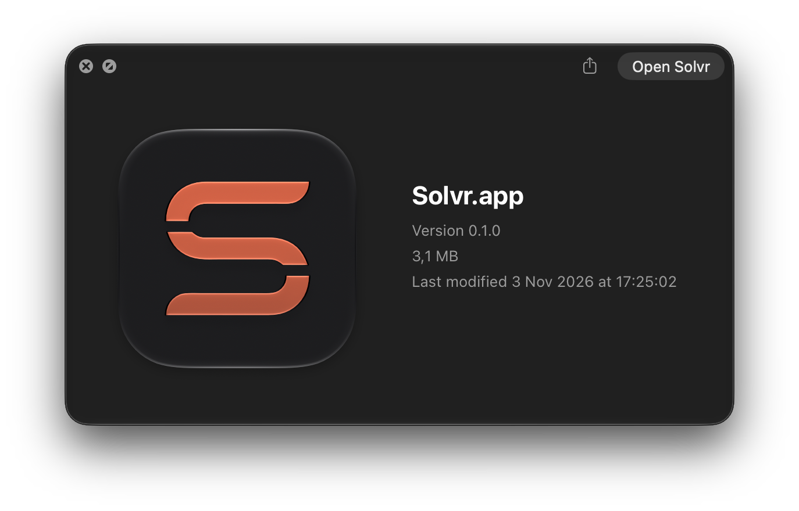
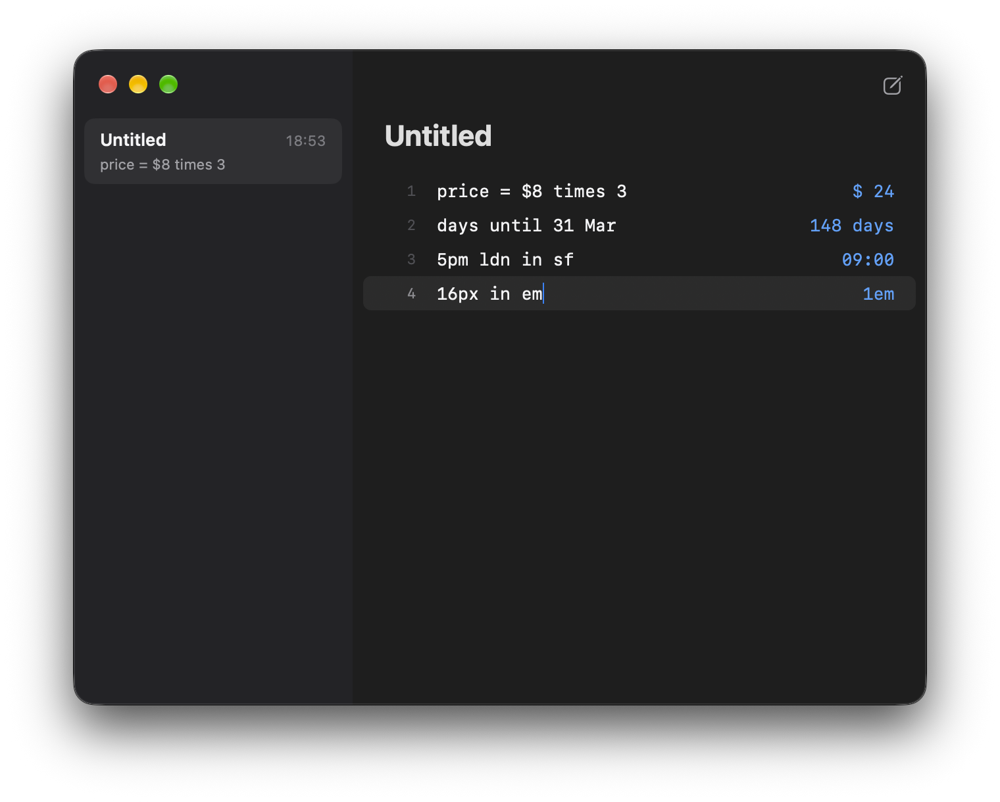

# Solvr

I'm building Solvr, a beautiful text calculator for Mac.

It calculates in text every day at work, and I wanted my sheets to stay saved between sessions, stay organized, and sync through iCloud.

<p align="center">
  
</p>

<p align="center">
  
</p>

## What it does

You type a line, and the result shows up next to it while you type. A sheet can hold a quick conversion during work or a budget you keep for months, because earlier lines and variables keep their meaning until you delete them.

```text
price = $8 times 3      $ 24
days until 31 Mar       148 days
5pm ldn in sf           09:00
16px in em              1em
```

It converts units, currencies, and cryptocurrencies, with exchange rates that update over the internet, and it converts time zones by abbreviation or by city name. When a line can't be calculated, it shows the reason in place of the result, and the rest of the sheet keeps working. The total at the bottom sums the results of the sheet.

Each sheet saves after every change, so there's no save button, and you can edit it without an internet connection.

## Install

Install it with Homebrew:

```sh
brew install adeonir/tap/solvr
```

Installing with the full name `adeonir/tap/solvr` adds the `adeonir/tap` tap for you and trusts only Solvr, not the rest of the tap. You can read the cask before installing with `brew cat adeonir/tap/solvr`.

You can also download `Solvr-<version>.zip` from the [releases page](https://github.com/adeonir/solvr/releases), unzip it, and move `Solvr.app` to Applications.

Solvr needs macOS 26 or later and runs on Apple Silicon and Intel Macs.
